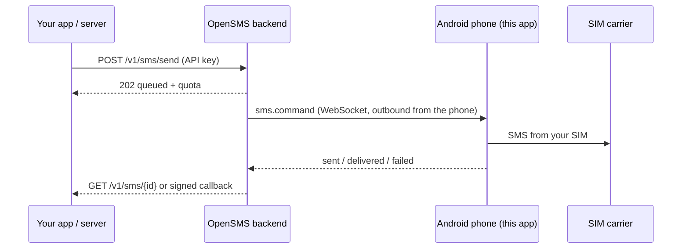

<div align="center">

# 📱 OpenSMS

**Turn your own Android phone into a private SMS gateway.**
Send text messages from your own SIM cards with a simple HTTPS API.


[**⬇️ Download the latest APK**](https://github.com/amjiddader/opensms/releases/latest) · [API docs](https://opensms.wansaw.com/docs) · [Examples](examples/) · [Protocol](docs/protocol/v1.md)

</div>

> [!WARNING]
> **Your SIM operator can block or suspend your SIM and services if you send spam, phishing, or SMS that look like OTPs or passwords.**
> OpenSMS sends ordinary SMS from your personal SIM. Carriers (for example in India under TRAI/DLT rules) filter and punish text that looks like marketing, one-time codes, passwords or bulk messaging from a normal number. Such messages are refused with `network_error` (SMS error 17) and repeated attempts can get the SIM restricted or barred.
> Send only messages you are allowed to send, to people who expect them, and keep volumes modest. You are responsible for the content you send and for your carrier's terms.

---

## ✨ What you get

- 🔐 **Private by design.** No cloud accounts. The phone connects *outward* to your own backend; nothing is exposed on your network.
- 📶 **Dual SIM aware.** Use SIM 1, SIM 2 or both; alternate between them, prefer one, or pick the one used least.
- 🧮 **Message quotas that make sense.** Daily limits count *messages*, per SIM and for the phone. The API tells you what is sent, pending and left.
- 🔁 **Smart retries.** If Android confirms a message was *not* sent, the app retries (default: once after 1 second, preferring the other SIM). A message that may already have gone out is never sent twice.
- 🧾 **Honest results.** `sent`, `delivered`, `failed`, `unknown` (never guessed), each with a readable reason.
- 🔔 **Callbacks.** Your server is notified with signed webhooks.
- 🪟 **Beautiful, fast UI.** Translucent "glass" design, light and dark, built with Jetpack Compose.
- 🛡️ **Admin approved.** Every phone must be approved before it can send anything (or auto-approve new phones if you choose).

## 🚀 Quick start

1. **Install** the APK from [Releases](https://github.com/amjiddader/opensms/releases/latest). Use `arm64-v8a` for almost every modern phone, or `universal` if unsure.
2. **Open the app**, accept the terms, grant *Send SMS* and *Phone* permissions, and allow background activity.
3. **Pick your home country** (detected from the SIM) and where messages may be sent, then choose your SIMs.
4. **Wait for approval.** The app shows *Waiting for approval*; tap **Refresh status** after the administrator approves.
5. **Create an API key** in *Settings → API keys* and send your first message:

```bash
curl https://opensms.wansaw.com/v1/sms/send \
  -H "Authorization: Bearer $OPENSMS_KEY" \
  -H "Content-Type: application/json" \
  -d '{"recipient":"+919876543210","message":"Hello from OpenSMS"}'
```

```jsonc
{
  "id": "job_01m55f844ts0vrhgefy2s1m0hc",
  "status": "queued",
  "recipient": "+91******3210",
  "quota": {                       // messages, for the SIMs that are enabled right now
    "unit": "messages", "date": "2026-10-17",
    "limit": 200, "sent": 12, "pending": 1, "remaining": 187,
    "sims": [
      { "sim": "sim_1", "enabled": true, "present": true, "limit": 100, "sent": 7, "remaining": 93 },
      { "sim": "sim_2", "enabled": true, "present": true, "limit": 100, "sent": 5, "remaining": 95 }
    ]
  }
}
```

## 🧩 How it works



## 📏 Rules and limits

| Topic | Rule |
| --- | --- |
| Message length | **Up to 100 characters** per message (`message_too_long` otherwise) |
| Daily limit | Counts **messages**, not SMS parts. Total = sum of the limits of the **enabled** SIMs, capped by the phone-wide and admin limits |
| Quota in responses | `POST /v1/sms/send`, `GET /v1/sms`, `GET /v1/sms/{id}` and `GET /v1/quota` return `quota` (limit, sent, pending, remaining, per SIM) |
| Numbers | Sent **exactly as you pass them** (10 digits, or with `+91`/country code). Numbers outside your allowed countries fail with `destination_not_supported` |
| Speed | The app paces sends (at least 2.1 s per message) to stay under Android's SMS rate limit |
| Retries | Settings → *Retry failed messages* (Off / 1× / 2× / 3×, wait 1–10 s). Only confirmed failures are retried |
| RCS | **Not supported.** Android offers no public RCS API, so every message goes out as normal SMS |

## 🧪 Examples

Ready-to-run clients that send an SMS, follow it until it is delivered, show your quota and verify webhook signatures:

| Language | File | Run |
| --- | --- | --- |
| Python | [`examples/example.py`](examples/example.py) | `OPENSMS_KEY=osk_… python3 example.py +919876543210` |
| JavaScript (Node 18+) | [`examples/example.js`](examples/example.js) | `OPENSMS_KEY=osk_… node example.js +919876543210` |
| Go | [`examples/example.go`](examples/example.go) | `OPENSMS_KEY=osk_… go run example.go +919876543210` |

Run them without a number to only read your quota and last messages.

## 🔋 Keep it running

Android likes to stop background apps. For a reliable gateway:

- Allow *Run in background* / *Unrestricted battery* for OpenSMS (the app guides you in **Settings → Reliability**).
- Turn off *Pause app activity if unused* and enable **Autostart** on Xiaomi, Oppo, Vivo, Huawei and Samsung phones.
- Keep the phone charged and online. A foreground notification shows the status.
- Do not force-stop the app.

## 🩺 Troubleshooting

| You see | Meaning | What to do |
| --- | --- | --- |
| `network_error` (error 17) | The carrier/network refused the SMS | Check signal and SMS balance. If it only happens for some texts, the carrier is filtering that wording (OTP-like or promotional text). Rephrase or stop sending such content |
| `no_service` / `radio_off` | No signal or airplane mode | Fix coverage; the app retries automatically |
| `limit_exceeded` | Android's SMS rate limit | Raise the pacing in Settings |
| `quota_exceeded` | Daily message limit reached | Wait for tomorrow or raise the limit in the app or admin panel |
| `destination_not_supported` | Number is outside your allowed countries | Settings → Destinations |
| `unknown` | The phone could not tell if the SMS left | Check the Sent folder; the app never resends these |
| Stuck on *Waiting for approval* | Not approved yet | Ask the administrator, then tap **Refresh status** |

## 🔒 Privacy and security

- Message text stays on the phone only until the message is sent. The backend keeps it encrypted and only until the phone accepts it; it is never written to the database. Backups are disabled; credentials stay in the Android Keystore.
- The `opensms.jks` signing key in this repository is **intentionally public** (personal-use project). Do not treat the APK signature as proof of trust; trust comes from administrator approval.
- **No API keys or secrets belong in this repository.** The only build-time setting is the backend URL.

## 🛠️ Build and release

- Local: `./gradlew :app:assembleDebug` (JDK 17, Android SDK 37). Point a debug build at a local backend with `-PapiBaseUrl=http://10.0.2.2:8787`.
- Release: GitHub → **Actions → Release → Run workflow**. It builds signed APKs for `arm64-v8a`, `armeabi-v7a`, `x86`, `x86_64` plus a universal APK and publishes a GitHub Release with `SHA256SUMS.txt`.
- Protocol: [`docs/protocol/v1.md`](docs/protocol/v1.md) and [callbacks](docs/protocol/callbacks.md).

## 📄 License

Apache-2.0, see [`LICENSE`](LICENSE).
